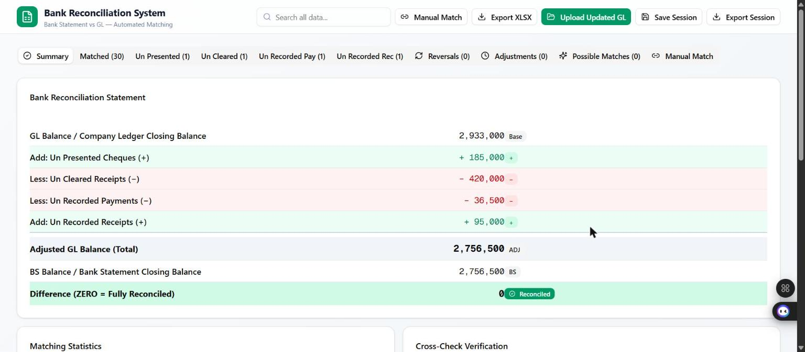
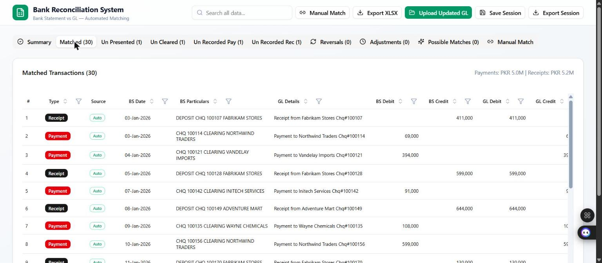

# Bank Reconciliation System

A local web app that reconciles a **bank statement (BS)** against a **general ledger (GL)** from Excel files. It matches transactions automatically and produces the standard reconciliation statement, ready to export to Excel.

Everything runs on your own computer: files are processed locally and nothing is uploaded anywhere.

## Screenshots

Screenshots use the made-up demo data in `sample-data/`.





## What it does

- Reads a single workbook with `BS` and `GL` sheets, or two separate files.
- Matches by cheque number, PSID, amount and description. Debits on the bank side pair with credits in the ledger, and the reverse.
- Splits what is left into: un-presented cheques, un-cleared receipts, un-recorded payments and un-recorded receipts.
- Detects reversals, suggests possible matches, and supports manual matching and manual adjustments.
- Shows the standard statement: GL balance, adjusting items, adjusted balance, bank balance, difference (zero means fully reconciled).
- **Preview & Map Columns** auto-detects columns for most Pakistani bank formats, and you can correct the mapping.
- Exports the statement and all lists to Excel, and saves or restores a session.

## Try it with the sample data

1. Run the app (below).
2. Choose **Single File**, upload `sample-data/demo_reconciliation.xlsx`, and click **Quick Run**.
3. Expected result: 30 matched pairs, 4 exceptions (one of each type), difference 0.

The sample GL sheet uses the default layout: `#`, Posting Date, Trans No, Origin, Origin No, Offset Account, Details, C/D (LC), Cumulative Balance, Debit, Credit, Blanket Agreement. Use **Preview & Map Columns** for any other layout.

## Run it

Requires [Node.js](https://nodejs.org/) 20 or newer.

```bash
npm install
npm run build
node .next/standalone/server.js
```

Or on Windows double-click `RUN.bat`, which builds on first run and opens http://localhost:3001. Use `REBUILD.bat` after changing the code.

## Built with

Next.js, React, TypeScript, Tailwind CSS, shadcn/ui, SheetJS (xlsx).

## Licence

MIT. See `LICENSE`.
